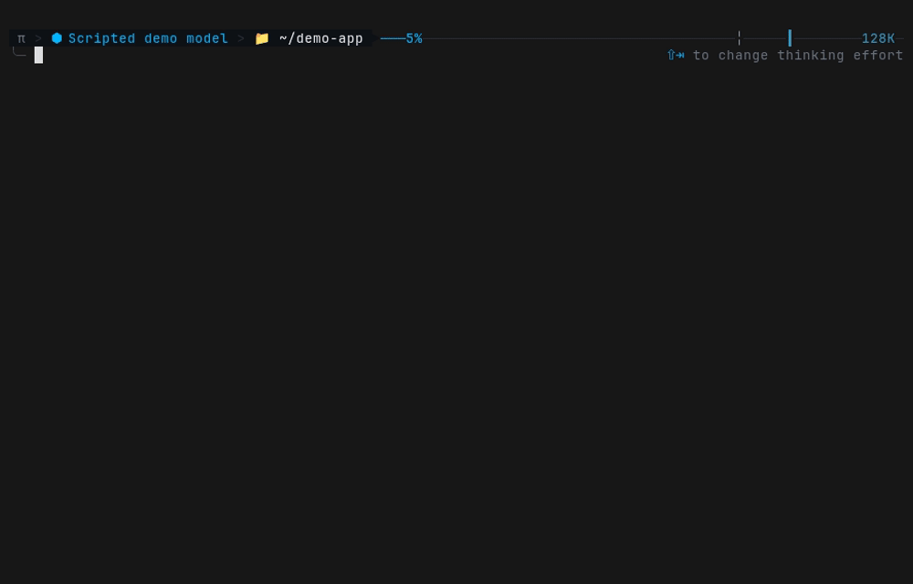

# omp-snippets

Reusable instructions for [omp](https://github.com/oh-my-pi/pi-coding-agent). Type `::name` anywhere in your message, keep preferences active, or select a conversation role.

| Expand | Pin | Select a role |
|---|---|---|
| `::name(args)` | `::pin(name)` | `::role-name` |
| One message | Every turn, until unpinned | One user-selected mode |

This repository is an omp [marketplace](https://github.com/oh-my-pi/pi-coding-agent) that hosts one plugin, `snippets`.

## Install

In omp:

```
/marketplace add open-frontier/omp-snippets
/marketplace install snippets@omp-snippets
```

Or from the command line:

```
omp plugin marketplace add open-frontier/omp-snippets
omp plugin install snippets@omp-snippets
```

## Snippets

Use an instruction once by typing its name in your message. Combine several, or pass arguments with `::name(args)`. It expands for that message; it is not automatically repeated on later turns.

```
::verify   → re-check each claim against concrete evidence
::reflect  → reflect on intent, then reformulate it clearly
```

Type `::` to browse the bundled snippets.

## Pinned snippets

Keep instructions active every turn without retyping them. Stack output styles such as `concise`, `html`, or `yoda` with working preferences such as `careful`.

```
::pin(concise) ::pin(careful)
::unpin(concise)
```

A *pinnable* snippet supports pinning; it only becomes *pinned* when you turn it on. You can still use it once with `::concise`. Pins remain until unpinned or omp exits; conflicting pins in the same group replace each other.

> **Q&A is a special pin:** `::pin(qa)` blocks non-read-only tool calls until `::unpin(qa)`. It can coexist with a role and is separate from native `/plan`. Other pins are advisory. See the [Q&A-only guard](./plugins/snippets/README.md#qa-only-guard-guard-qa).

## Roles

A role also keeps instructions active, but occupies one separate slot for the main conversation. You choose it, not the model. Selecting another replaces it, and `::unrole` clears it without removing your pins.

Use a role for a sustained perspective or way of working, while keeping your preferred output styles pinned. The selected role is saved with the session and restored on resume or branch; it does not start a separate agent.

> **Custom example, not bundled:** after defining a `release-captain` snippet with `kind: role`, select or clear it like this. Roles take no arguments.

```
::release-captain
::unrole
```

See [Roles](./plugins/snippets/README.md#roles--role-name-and-unrole) for lifetime, prompt placement, and authoring.

## Using the picker

Type `::` and filter by name. Use Up/Down to move and Escape to close. Toggling keeps the picker open and leaves your message unchanged.

| Selected row | Enter | Right arrow | Tab |
|---|---|---|---|
| Snippet | Insert | Move cursor | Insert |
| Pinnable | Pin / unpin | Pin / unpin | Insert |
| Role | Select / clear | Move cursor | Insert |

Enter applies a role immediately; Tab inserts its trigger for selection when you send. Parameterized pins use their blank-argument default in the picker; type `::pin(max-chars(500))` to choose a value. See [Live picker](./plugins/snippets/README.md#live-picker) for ordering and colors.

## Demo



This is the existing recording; the picker shortcuts above describe the updated behavior. A second recording shows the [Q&A-only guard refusing a write, then a role](./docs/demo/guard-roles.gif).

## Bundled snippets

All 28 examples ship with the plugin. Type the name with `::` to use one once; pinnable examples can also be pinned.

| Snippet | Type | What it does |
|---|---|---|
| [`brainstorm`](./plugins/snippets/examples/brainstorm.md) | One-shot | Brainstorm options and tradeoffs until a decision |
| [`bugfix`](./plugins/snippets/examples/bugfix.md) | One-shot | Delegate this bug fix to a background subagent |
| [`chain`](./plugins/snippets/examples/chain.md) | One-shot | Run the following steps as an ordered pipeline |
| [`drift`](./plugins/snippets/examples/drift.md) | One-shot | Compare intended versus actual outcome for drift |
| [`explain_fix`](./plugins/snippets/examples/explain_fix.md) | One-shot | Explain the issue and propose concrete fixes |
| [`fanout`](./plugins/snippets/examples/fanout.md) | One-shot | Fan out independent read-only steps, then join |
| [`reflect`](./plugins/snippets/examples/reflect.md) | One-shot | Reflect on intent, then reformulate it clearly |
| [`report`](./plugins/snippets/examples/report.md) | One-shot | Report current thread status from the template |
| [`runbackground`](./plugins/snippets/examples/runbackground.md) | One-shot | Run this task in a background subagent |
| [`sidetrack`](./plugins/snippets/examples/sidetrack.md) | One-shot | Take a brief detour, then return to the topic |
| [`subagent`](./plugins/snippets/examples/subagent.md) | One-shot | Spawn a subagent to handle this off-thread |
| [`tradeoff`](./plugins/snippets/examples/tradeoff.md) | One-shot | Give a balanced advantages/disadvantages analysis |
| [`verify`](./plugins/snippets/examples/verify.md) | One-shot | Re-check each claim against concrete evidence |
| [`bluf`](./plugins/snippets/examples/bluf.md) | Style pin | Lead with the one-sentence answer, then details |
| [`bluf-insight`](./plugins/snippets/examples/bluf-insight.md) | Style pin | Lead with the answer, then insight where it helps |
| [`concise`](./plugins/snippets/examples/concise.md) | Style pin | Answer concisely in plain language, no fluff |
| [`explanatory`](./plugins/snippets/examples/explanatory.md) | Style pin | Add educational insights alongside the work |
| [`html`](./plugins/snippets/examples/html.md) | Style pin | Deliver the answer as a self-contained HTML page |
| [`informative`](./plugins/snippets/examples/informative.md) | Style pin | Thorough explanations of reasoning and tradeoffs |
| [`max-chars`](./plugins/snippets/examples/max-chars.md) | Style pin | Hard-cap every response at a set character limit |
| [`show`](./plugins/snippets/examples/show.md) | Style pin | Present the topic visually in the chosen format |
| [`socratic`](./plugins/snippets/examples/socratic.md) | Style pin | Answer with questions instead of the answer |
| [`ste100`](./plugins/snippets/examples/ste100.md) | Style pin | Write in ASD-STE100 aerospace maintenance style |
| [`yoda`](./plugins/snippets/examples/yoda.md) | Style pin | Speak like Yoda with inverted word order |
| [`careful`](./plugins/snippets/examples/careful.md) | Behavior pin | Think step by step and double-check changes |
| [`confirm-first`](./plugins/snippets/examples/confirm-first.md) | Behavior pin | Propose the change first, then await approval |
| [`direct-evidence`](./plugins/snippets/examples/direct-evidence.md) | Behavior pin | Answer directly with evidence, no praise |
| [`q&a`](./plugins/snippets/examples/q%26a.md) | Guarded pin | Stay read-only while pinned; unpin to allow changes |

Pinnable examples can also be used once. `q&a` is a guarded pin, not a role. No roles are bundled.

## Full documentation

See the [catalog and authoring guide](./plugins/snippets/README.md) for aliases, pin groups, arguments, and creating your own snippets or roles. For how snippets differ from skills and slash commands, see [Snippets vs. skills vs. slash commands](./plugins/snippets/README.md#snippets-vs-skills-vs-slash-commands).

## License

MIT — see [LICENSE](./LICENSE). The plugin package carries its own copy at [`plugins/snippets/LICENSE`](./plugins/snippets/LICENSE), because the package archive does not include the repository root. This project incorporates portions of other MIT-licensed software; see [`plugins/snippets/THIRD_PARTY_NOTICES.md`](./plugins/snippets/THIRD_PARTY_NOTICES.md) for the specific code regions and upstream copyright notices those regions require retaining.
